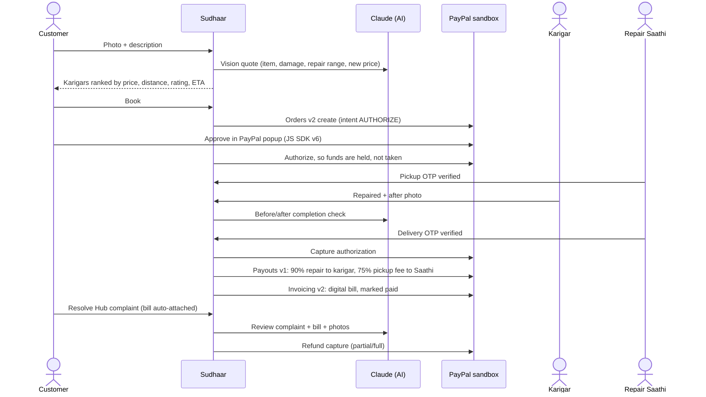

# Sudhaar — Repair, don't replace

**A doorstep repair marketplace for local karigars (informal repairers), built on PayPal + AI.**
Snap a photo of something broken. AI estimates the repair cost against the price of buying new. A verified local karigar fixes it, a Repair Saathi does the pickup and delivery, and the customer's PayPal payment is **held until the repaired item is back in their hands**. On the delivery OTP, PayPal captures the money and **instantly pays out the karigar and the Saathi**.

> Built for the [PayPal AI Hackathon 2026](https://paypalaihackathon.devpost.com/).
> 🎥 Demo video: _add YouTube link_ · 🌐 Live demo: _add Render URL_

---

## Why we built this

This Diwali, my mother was sorting old things at home that only needed a small repair. Even though we live in a city, she struggled to find anyone to fix them. The karigars (cobblers, tailors, mixer and fan repairers) are right there in our neighbourhood, but nobody can find them online, nobody comes home to collect the items, and nobody knows what a fair price is. So people buy new and throw the old one away.

Sudhaar fixes each of those problems:

| Problem | How Sudhaar solves it |
|---|---|
| "I don't know a good repairer nearby" | Verified karigars compared side by side by price, rating, **distance** and ready time |
| "I have to carry it to a shop and go back" | **Repair Saathi** pickup and delivery (plumbers and electricians do home visits) |
| "Is it worth repairing?" | **AI Snap & Quote**: repair-cost range vs. new price, so you see the saving |
| "I'll get overcharged / I can't trust a stranger" | Price shown upfront, **PayPal holds the money** until delivery, OTP at every handover |
| "What if it breaks again?" | 15-day warranty and **Resolve Hub**: complaint with the PayPal invoice attached, AI review, PayPal refund |
| Karigars get few customers and get paid late | Free listing, karigar keeps **90%** of the repair charge, **instant PayPal payout** |

## What it does (end to end)



### Repair Agent (agentic commerce)
`/agent` is a Claude tool-use agent that **acts for the customer**: *"My mixer jar blade is loose, get it fixed under $8 by Friday."* It quotes the job (with vision if a photo is attached), picks the karigar against the budget and deadline, **books it and creates the PayPal order**, tracks status, files warranty claims and **issues refunds up to a $5 policy limit that is enforced in code**. It uses **PayPal Agent Toolkit** tools for PayPal lookups (orders, invoices, refunds, transactions, disputes). The customer approves every payment in the PayPal popup, so the agent can never spend money on its own.

## How PayPal is used

All calls go to the PayPal **sandbox**. Every PayPal id appears on the order page and in the admin grid, so you can verify each one in the sandbox dashboard.

| PayPal capability | Where | What Sudhaar does with it |
|---|---|---|
| **JavaScript SDK v6** (`paypal-payments`, `<paypal-button>`) | [`components/PayPalCheckout.tsx`](components/PayPalCheckout.tsx) | Checkout popup on the order page and inside the agent chat |
| **Orders v2, intent `AUTHORIZE`** | [`lib/paypal.ts`](lib/paypal.ts) `createAuthorizeOrder`, `authorizeOrder` | Holds the customer's money at booking, works like escrow |
| **Payments v2 capture / void** | `captureAuthorization`, `voidAuthorization` | Captures only after the delivery OTP; voids if the customer cancels before pickup |
| **Payouts v1** | `sendPayouts` | Instant split to the karigar and the Saathi the moment the job is confirmed |
| **Invoicing v2** | `createPaidInvoice` | Generates, sends and marks paid a PayPal invoice: the "digital bill" used by Resolve Hub |
| **Refunds (Payments v2)** | `refundCapture` | Partial or full refunds from Resolve Hub (support desk or agent within limit) |
| **Webhooks** | [`app/api/paypal/webhook/route.ts`](app/api/paypal/webhook/route.ts) | Verifies signatures (`verify-webhook-signature`) and logs events on the order |
| **PayPal Agent Toolkit** | [`lib/agent.ts`](lib/agent.ts) | `get_order`, `get_invoice`, `list_invoices`, `get_refund`, `list_transactions`, `list_disputes` as agent tools |

## How AI is used

Claude (`claude-opus-5-5`, via the official `@anthropic-ai/sdk`) with structured outputs ([`lib/ai.ts`](lib/ai.ts)):

1. **Snap & Quote**: vision → item, category, size, damage, repair price range, new price, turnaround, confidence.
2. **Completion check**: compares before/after photos **before the PayPal capture is allowed**.
3. **Resolve Hub review**: reads the complaint, the PayPal invoice data and the photos, then recommends re-repair, partial refund or full refund under the warranty policy.
4. **Repair Agent**: multi-step tool use that books and pays (see above).

Without an `ANTHROPIC_API_KEY`, features 1–3 fall back to a deterministic estimator that is clearly labelled "Simulated" in the UI. The agent needs a key.

## Sponsor tools

- **AG Grid**: the operations dashboard at `/admin` (orders, payouts, karigars, PayPal webhooks) with sorting, filtering and pagination.
- **Render**: one-click deploy via [`render.yaml`](render.yaml).
- **Postman**: [`postman/Sudhaar.postman_collection.json`](postman/Sudhaar.postman_collection.json) drives the whole flow through the API.

## Run it locally

Requirements: Node 20+.

```bash
git clone https://github.com/meenakshisatpathy20-del/sudhaar-paypal.git
cd sudhaar-paypal
npm install
cp .env.example .env      # fill in the values below
npm run smoke:paypal      # optional: checks your PayPal sandbox credentials
npm run dev               # http://localhost:3000
```

The app also runs with an **empty `.env`**: PayPal and AI calls are then simulated and the header shows yellow "Simulated" badges. For judging, use sandbox keys so the real PayPal flow runs.

### PayPal sandbox setup (5 minutes)
1. [developer.paypal.com](https://developer.paypal.com/) → **Apps & Credentials** → *Sandbox* → **Create App**. Copy the Client ID and Secret into `PAYPAL_CLIENT_ID` / `PAYPAL_CLIENT_SECRET`.
2. In the app's features, make sure **Payouts** and **Invoicing** are enabled.
3. **Sandbox → Accounts**: create two *Personal* accounts for the karigar and the Saathi. Put their emails in `PAYPAL_KARIGAR_EMAIL` / `PAYPAL_SAATHI_EMAIL`. Use the default sandbox *Personal* account as the buyer (`PAYPAL_CUSTOMER_EMAIL`).
4. Optional: add a webhook pointing to `https://<your-host>/api/paypal/webhook` and put its id in `PAYPAL_WEBHOOK_ID`.

### Environment variables
| Variable | Required | Purpose |
|---|---|---|
| `PAYPAL_CLIENT_ID`, `PAYPAL_CLIENT_SECRET` | for real PayPal | Sandbox REST app credentials |
| `PAYPAL_KARIGAR_EMAIL`, `PAYPAL_SAATHI_EMAIL` | for real payouts | Sandbox personal accounts that receive payouts |
| `PAYPAL_CUSTOMER_EMAIL` | optional | Invoice recipient fallback |
| `PAYPAL_WEBHOOK_ID` | optional | Enables webhook signature verification |
| `ANTHROPIC_API_KEY` | for real AI + agent | Claude API key |
| `AI_MODEL` | optional | Defaults to `claude-opus-5-5` |
| `DEMO_CENTER_LAT/LNG`, `DATA_DIR` | optional | Demo location and data folder |

## Testing instructions for judges

**Hosted demo:** _Render URL_. Sandbox buyer login: `_buyer email_` / `_password_` _(team: fill in before submitting)_.

1. **Customer** tab → tap a sample chip (e.g. "Mixer grinder jar…") or upload a photo → **Get AI repair quote**.
2. Pick a karigar → **Book & continue to PayPal** → pay with the sandbox buyer. The status becomes **"Paid · on hold"** (authorization id shown).
3. Open **Saathi** in another tab → enter the **pickup OTP** shown on the order page → *Handed to karigar*.
4. Open **Karigar** → *Inspect & start repair* → upload an after photo → **Mark repaired** (the AI completion check runs).
5. **Saathi** → *Collect & go* → enter the **delivery OTP** → PayPal **captures**, sends **payouts**, and issues the **invoice** (ids appear on the order page).
6. Order page → **Resolve Hub** → submit a complaint → AI recommends an action → **Approve PayPal refund**.
7. **Repair Agent** → "My school bag zip broke. Get it fixed under $5." → approve the PayPal payment inside the chat.
8. **Admin** → AG Grid views of orders, payouts, karigars and PayPal webhooks. *Reset demo data* clears orders.

## Project structure

```
app/                Next.js App Router pages + API routes
  api/              quote, orders (+approve/action/complaint/resolve), agent, admin, uploads, paypal/webhook
  agent/ saathi/ karigar/ admin/ orders/[id]/
components/         UI (PayPal SDK v6 checkout, photo picker, timeline…)
lib/
  paypal.ts         PayPal REST client (Orders, Payments, Payouts, Invoicing, Webhooks)
  ai.ts             Claude: quote, completion check, complaint review
  agent.ts          Repair Agent (Claude tool use + PayPal Agent Toolkit)
  orders.ts         Order state machine, OTP checks, settlement, Resolve Hub
  pricing.ts        Rate card (distance × size), split, haversine
  db.ts / seed.ts   JSON-file store with seeded demo karigars
postman/            Postman collection for the full flow
scripts/            PayPal sandbox smoke test
```

## Notes
- Prices are in **USD** because the demo runs on the PayPal sandbox; they mirror real street-repair rates in Indian cities (roughly ₹85 = $1).
- Data lives in a JSON file (`data/db.json`) that is re-seeded automatically, so a fresh deploy always works.
- Built from scratch during the hackathon submission period (October–November 2026).

## License
[MIT](LICENSE)
