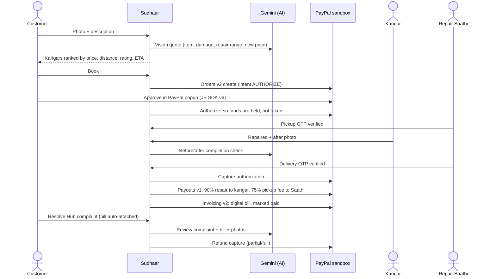

# Sudhaar — Repair, don't replace

**A doorstep repair marketplace for local karigars (informal repairers), built on PayPal + AI.**
Snap a photo of something broken. AI estimates the repair cost against the price of buying new. A verified local karigar fixes it, a Repair Saathi does the pickup and delivery, and the customer's PayPal payment is **held until the repaired item is back in their hands**. On the delivery OTP, PayPal captures the money and **instantly pays out the karigar and the Saathi**.

> Built by **Meenakshi Satpathy** (solo) for the [PayPal AI Hackathon 2026](https://paypalaihackathon.devpost.com/).
> 🌐 **Live demo:** the *Website* link in this repository's About section · 🎥 **Demo video:** on the Devpost project page · 📸 **[Screenshots](docs/SCREENSHOTS.md)** · 🧭 **[Demo guide: every page and feature](docs/DEMO-GUIDE.md)** (also in the app at `/guide`)

---

## Why I built this

This Diwali, my mother was sorting old things at home that only needed a small repair. Even though we live in a city, she struggled to find anyone to fix them. The karigars (cobblers, tailors, mixer and fan repairers) are right there in our neighbourhood, but nobody can find them online, nobody comes home to collect the items, and nobody knows what a fair price is. So people buy new and throw the old one away.

Sudhaar fixes each of those problems:

| Problem | How Sudhaar solves it |
|---|---|
| "I don't know a good repairer nearby" | Verified karigars compared side by side by price, rating, **distance** and ready time |
| "I have to carry it to a shop and go back" | **Repair Saathi** pickup and delivery (plumbers and electricians do home visits) |
| "Is it worth repairing?" | **AI Snap & Quote**: repair-cost range vs. new price, so you see the saving |
| "I'll get overcharged / I can't trust a stranger" | Price shown upfront, **PayPal holds the money** until delivery, OTP at every handover |
| "What if it breaks again?" | 15-day warranty and **Resolve Hub**: complaint with the PayPal invoice attached, AI review, PayPal refund |
| Karigars get few customers and get paid late | Free listing, karigar keeps **90%** of the repair charge, **instant PayPal payout** |

## What it does (end to end)



### Repair Agent (agentic commerce)
`/agent` is a Gemini function-calling agent that **acts for the customer**: *"My mixer jar blade is loose, get it fixed under $8 by Friday."* It quotes the job (with vision if a photo is attached), picks the karigar against the budget and deadline, **books it and creates the PayPal order**, tracks status, files warranty claims and **issues refunds up to a $5 policy limit that is enforced in code**. It uses **PayPal Agent Toolkit** tools for PayPal lookups (orders, invoices, refunds, transactions, disputes). The customer approves every payment in the PayPal popup, so the agent can never spend money on its own.

### 🪔 Ghar Safai Mode (my favourite feature)
Born from my mother's Diwali cleaning: walk around the house and snap every broken thing (a bag zip, a chappal, the mixer). Gemini quotes each item, the best karigar is picked for each, **one Repair Saathi collects everything in one trip** (cheaper than separate pickups), and the customer makes **one PayPal payment**. On delivery PayPal captures it once and **Payouts splits it to every karigar for their own items** plus the Saathi. Each karigar repairs only their items in the Karigar app, with an AI photo check per item.

### 💞 Family Pay
Many parents live alone while their children work in other cities. A parent books the repair (even by voice), picks *Someone else pays*, and shares a WhatsApp link. The son or daughter opens `/pay/<order>` and **approves the PayPal payment from their own account**. The money is still only held until the item is back home.

### Built for real people
- **8 languages**: English, हिंदी, বাংলা, मराठी, తెలుగు, தமிழ், ଓଡ଼ିଆ and ಕನ್ನಡ, switchable from the language picker on every screen: booking, tracking, OTPs, Resolve Hub, the Family Pay link, the join forms and the Karigar and Saathi apps. Each script uses its own Noto font. The translations are new, so the picker invites people to report anything that reads oddly.
- **Talk to Sudhaar**: speak in the app's language (browser speech recognition in hi-IN, ta-IN, bn-IN …; support depends on the browser and device), and the agent replies in that language and **reads its replies aloud**, for elderly users and karigars who don't type.
- **Prices in rupees**, with the exact USD amount PayPal handles shown under each total.
- **Installable on a phone** (add to home screen) with a bilingual offline page and an offline banner for weak networks.
- **Join as a karigar or a Repair Saathi**: repairers and pickup partners (students, local volunteers) apply from the customer app in their own language. The team checks ID in person (no ID numbers collected), then visits the karigar's shop and gives a trial repair, or trains the Saathi and does a trial trip. On approval, the new partner gets their own login PIN.
- **Pick a pickup time**: customers choose when the Saathi comes (e.g. *Today, 5–7 pm*); the Saathi sees it on their trip and plumbers or electricians see their visit time.
- **Rate, review and tip after delivery**: customers rate each karigar and can leave a review marked *Verified repair*. Ratings, job counts and reviews update for real; a new karigar shows "New" until someone rates them. An optional thank-you tip (₹20, ₹50 or ₹100) is paid through PayPal, and **all of it** goes to the karigar.
- **Book again**: one tap on a past repair starts a new quote with the same karigar.
- **Fix-or-Replace meter**: shows how much of the new price a repair saves.
- **Item Passport**: every repaired item gets a "second life" card with money saved and waste avoided.
- **Karigar profiles** (craft, years of experience, languages, reviews, price list) and a **real OpenStreetMap map** with the customer's home, karigar pins and the Saathi moving along the route. Customers can share their **live location** at sign-up or from Profile, and distances and pickup fees are measured from there.
- Warm, hand-drawn **doodle illustrations** with a light **three.js** scene, designed for everyday phones.
- A **customer app** (Home · My Repairs · Talk · Profile) kept separate from the **partner side**. Each partner logs in with their own phone + PIN and sees only their own work:
  - **Karigar app**: a desktop dashboard with earnings, this week, tips and rating; a **job board by stage** (coming to you → on your bench → ready to go back); inspect and start, **ask the customer to approve a new price** when the damage turns out bigger, after photo and AI check; a 7-day payouts chart; **verified reviews**; **My shop** to edit the rate card, bio and turnaround; earnings with a **"Check payout status with PayPal"** button (Payouts API); online/offline switch.
  - **Saathi app**: trips with OTP handovers, a **numbered route map** with directions, **live location sharing** (GPS or a labelled demo ride), earnings with the PayPal payout check, km ridden, a handover checklist, and a profile (area, vehicle used for ETAs).
  - **Admin console**: an **overview of where the money is** (held, captured, paid out, refunded, tips, discounts, Care billing) with every PayPal API in use and the latest PayPal calls; a **PayPal activity** log; orders, payouts, customers, karigars and Saathis (AG Grid); Resolve Hub refunds; Photo checks; partner applications; **coupons**; **Sudhaar Care members**; the **live Saathi fleet** map; webhooks; and the system check.
- **A demo guide inside the app** (`/guide`, linked from the bar at the top and the footer): one-tap logins for all four roles, the whole journey step by step, and every page with what to try and the APIs behind it.

### 📦 Shiprocket-style live tracking
Every booking gets a tracking number and a **shareable tracking link** (`/track/<order>?t=…`) that a son or daughter can open without logging in. It shows a step-by-step timeline with times, the karigar shop, the Saathi and **the Saathi's live position with an ETA**. The Saathi app shares the phone's GPS while riding (or a clearly labelled **demo ride** so judges can watch it from a desk), and the ETA uses the Saathi's vehicle (walk, bicycle, scooter, motorbike). The page never shows OTPs, prices or the exact home address. The Saathi app plans the day as a **numbered route** (nearest stop first) on the map, with directions for each stop, and the admin console shows the **live fleet**.

### 💳 Sudhaar Care (PayPal Subscriptions)
A monthly plan (₹169, billed $1.99/month by PayPal in the sandbox) for homes that repair often: **free doorstep pickup on every repair** and a **30-day warranty** instead of 15 days. It uses the PayPal **Catalog Products → Billing Plans → Subscriptions** APIs: the customer approves on PayPal, comes back to Sudhaar, and the server **asks PayPal for the subscription status** before switching Care on (it never trusts the return link alone). Cancelling calls the Subscriptions cancel API, and **webhooks** (`BILLING.SUBSCRIPTION.*`, `PAYMENT.SALE.COMPLETED`) keep the membership in step. Members' bookings show the pickup fee as a PayPal **discount line**; Sudhaar still pays the Saathi their full share.

### 🎟️ Coupons
Codes such as `FIRSTFIX` (₹50 off a first repair), `DIWALI25` (₹25 off above ₹200) and `GHARSAFAI` (15% off baskets). Every code is checked on the server (first order only, baskets only, minimum order, once per customer, usage limit, expiry) when it's applied **and again when booking**. The discount comes out of **Sudhaar's own share** and is capped by it, so **the karigar and Saathi are always paid in full**; it reaches PayPal as `breakdown.discount` on the order and `invoice_discount` on the invoice. The admin console creates codes, switches them off and shows how often each was used.

### 🧾 Fair price changes
A karigar sometimes finds more damage after opening the item. They can't just charge more: they send a new price with a reason, the customer approves or declines it in the app, and an increase is paid as a **second PayPal authorization** for only the difference. The repair can't be marked done while a price change is waiting. On delivery both holds are captured, and a later refund is split across both captures.

## How PayPal is used

All calls go to the PayPal **sandbox**. Every PayPal id appears on the order page and in the admin grid, so you can verify each one in the sandbox dashboard.

| PayPal capability | Where | What Sudhaar does with it |
|---|---|---|
| **JavaScript SDK v6** (`paypal-payments`, `<paypal-button>`) | [`components/PayPalCheckout.tsx`](components/PayPalCheckout.tsx) | Checkout popup on the order page and inside the agent chat |
| **Orders v2, intent `AUTHORIZE`** | [`lib/paypal.ts`](lib/paypal.ts) `createAuthorizeOrder`, `authorizeOrder` | Holds the customer's money at booking, works like escrow. Coupons and Sudhaar Care are sent as `amount.breakdown.discount` against itemised lines |
| **Second authorization for a price increase** | `createTopUpOrder` | If the customer approves a karigar's higher price, only the difference is authorized as its own PayPal order and captured with the first |
| **Payments v2 capture / void** | `captureAuthorization`, `voidAuthorization` | Captures only after the delivery OTP; voids if the customer cancels before pickup |
| **Orders v2, intent `CAPTURE`** | `createTipOrder`, `captureOrder` | Thank-you tips are paid immediately (no hold), then paid out in full to the karigar in their own Payouts batch |
| **Payouts v1** | `sendPayouts`, `getPayoutBatch` | Instant split to the karigar(s) and the Saathi the moment the job is confirmed. A Ghar Safai basket pays several karigars from one payment. Partners press *Check payout status with PayPal* to refresh each batch's status |
| **Invoicing v2** | `createPaidInvoice` | Generates, sends and marks paid a PayPal invoice (with `invoice_discount` for coupons / Care): the "digital bill" used by Resolve Hub |
| **Catalog Products + Billing Plans v1** | `createCareProduct`, `createCarePlan` | Creates the Sudhaar Care product and monthly plan the first time anyone subscribes |
| **Subscriptions v1** | `createSubscription`, `getSubscription`, `cancelSubscription` ([`lib/care.ts`](lib/care.ts)) | Customer approves on PayPal; Sudhaar confirms the status with PayPal before activating; cancel from the app |
| **Refunds (Payments v2)** | `refundCapture` | Partial or full refunds from Resolve Hub (support desk or agent within limit), split across both captures when there was a price increase |
| **Webhooks** | [`app/api/paypal/webhook/route.ts`](app/api/paypal/webhook/route.ts) | Verifies signatures (`verify-webhook-signature`), logs events on the order, and (only when verified) updates Sudhaar Care from `BILLING.SUBSCRIPTION.*` and `PAYMENT.SALE.COMPLETED` |
| **PayPal Agent Toolkit** | [`lib/agent.ts`](lib/agent.ts) | `get_order`, `get_invoice`, `list_invoices`, `get_refund`, `list_transactions`, `list_disputes` as agent tools |

## How AI is used in the product

Google **Gemini** (`gemini-flash-latest` by default, via Google's official `@google/genai` SDK) with JSON-schema structured outputs and function calling ([`lib/llm.ts`](lib/llm.ts), [`lib/ai.ts`](lib/ai.ts)). A free API key from Google AI Studio is enough to run it:

1. **Snap & Quote**: vision → item, category, size, damage, repair price range, new price, turnaround, confidence.
2. **Completion check**: compares before/after photos **before the PayPal capture is allowed**. If the AI rejects a repair or is unavailable, the money stays held and the photos go to a person in **Admin console → Photo checks**. An error never releases a payment.
3. **Resolve Hub review**: reads the complaint, the PayPal invoice data and the photos, then recommends re-repair, partial refund or full refund under the warranty policy.
4. **Repair Agent**: multi-step tool use that books and pays (see above).

Without a `GEMINI_API_KEY`, features 1–3 fall back to a deterministic estimator that is clearly labelled "Simulated" in the UI. The agent needs a key. If Gemini is busy or over its usage limit, quotes fall back to the price table, photo checks go to a person, and the agent asks the customer to try again in a minute.

## How I built it (and how I used AI)

I'm a solo participant, a 3rd-year Computer Science student.

**My part:** I came up with the idea from a real problem at home, researched it, and designed the product and its features: OTP handovers, Repair Saathi pickup by local volunteers and students, Shiprocket-style distance pricing and tracking, Resolve Hub complaints with bill proof, KYC-verified karigars, and a fair split so karigars keep 90%. I also did the testing in the PayPal sandbox and made the demo video.

**AI as my coding assistant:** I used Claude Code (Anthropic's AI coding assistant) to turn my design into code. The first commit, the initial app, was generated with Claude Code from my specification. Later changes, fixes and new features were also written with Claude Code, following my product decisions and feedback, and I reviewed and tested them.

## Sponsor tools

- **AG Grid**: the Admin console at `/admin` (partner side) (orders, payouts, karigars, PayPal webhooks) with sorting, filtering and pagination.
- **Render**: one-click deploy via [`render.yaml`](render.yaml).
- **Postman**: [`postman/Sudhaar.postman_collection.json`](postman/Sudhaar.postman_collection.json) drives the whole flow through the API.

## Testing instructions for judges

**Hosted demo:** open the *Website* link in this repository's About section. It runs against the PayPal sandbox. Log in to PayPal with the sandbox buyer account shown **right under the PayPal button** (also in the testing instructions on the Devpost page). It's a PayPal sandbox account with test money only. On the free hosting plan, the first load can take about a minute while the server wakes up.

**Fastest way in:** open **`/guide`** in the app (the green bar at the top links to it). It has one-tap logins for the customer, Saathi, karigar and admin, the whole journey step by step, and a table of every page. The full written version is **[docs/DEMO-GUIDE.md](docs/DEMO-GUIDE.md)**.

**Demo logins** (each role sees only its own app and data; real users sign up with their own phone + PIN):

| Role | Where | Phone | PIN | One tap |
|---|---|---|---|---|
| Customer (Anita) | any "Log in" | 9999999999 | 1234 | **Try the demo account** |
| Karigar | `/partner` | 9000000003 (Mohan) | 1111 | **Karigar** demo button: opens the karigar of the latest booking |
| Other sample karigars | `/partner` | 9000000001 … 9000000008 | 1111 | |
| Saathi (Vikas / Pooja) | `/partner` | 9100000001 / 9100000002 | 2222 | **Saathi** demo button: opens the Saathi of the latest booking |
| Admin | `/partner` | 9000000000 | 2026 | **Admin** demo button |

The demo buttons open the karigar and Saathi of the most recent booking that's waiting on them, so you always land on your own test order.

1. **Home** → tap a category (e.g. *Mixer & fan*), type or **speak** the problem (🎤) or upload a photo → **Get AI quote** → see the **Fix-or-Replace meter**. Use the **language picker** (EN ▾) at the top at any point to switch the whole app, e.g. to हिंदी or தமிழ்.
2. **Choose your karigar** (list or map) → **Book & pay with PayPal** → pay with the sandbox buyer. The status becomes **"Paid · on hold"** (authorization id shown) and live tracking starts.
3. In another browser (or a private window, so both logins stay active) open **`/partner`** and log in as the **Saathi** → enter the **pickup OTP** the customer reads out from their order page (Saathis never receive OTPs) → *Handed to karigar*.
4. **Karigar app** (`/partner`, Karigar demo button) → *Inspect & start repair* → optionally **Change price after inspection** with a reason (*Ask the customer*); the customer approves it on their order page and pays the difference in a second PayPal popup → upload an after photo → **Mark repaired** (the AI completion check runs). If the AI rejects the photo or is unavailable, the money stays held and the repair appears in **Admin console → Photo checks** for a person to approve or send back.
5. **Saathi app** → *Collect from karigar & go* → enter the **delivery OTP** → PayPal **captures**, sends **payouts** and issues the **invoice**. The order page shows the ids and an **Item Passport**.
6. Order page → **Resolve Hub** → *Report an issue* → AI recommends an action → in the **Admin console → Resolve Hub** tab, **Approve PayPal refund** → the customer's order shows the refund.
7. **Ghar Safai Mode** (home page banner) → add 2–3 items (e.g. *school bag zip*, *chappal sole*, *mixer blade*) → see the one-trip saving → **Review & pay once**. Optionally tick **Someone else pays**, enter a name and open the shared `/pay/…` link to pay as the family member. In the Karigar app, switch between karigars to repair each one's items; after delivery the order shows **one capture and one payout per karigar**.
8. **Talk** tab → tap the mic or type "My school bag zip broke. Get it fixed under ₹400." → approve the PayPal payment inside the chat. Replies are read aloud.
9. **Admin console** (partner side) → AG Grid views of **orders, customers, karigars, Saathis, payouts and PayPal webhooks**, plus the **Resolve Hub** queue where refunds are approved, the **Photo checks** queue for repairs the AI could not pass, and **Applications** from new karigars. *Reset demo data* clears orders.
10. **Join as a karigar** (banner at the bottom of the home page, or `/join`) → apply → in **Admin console → Applications** tick the three KYC checks → **Approve and list karigar**, which shows the new karigar's login PIN → the new karigar appears in quotes with a **"New"** badge instead of a made-up rating and can log in at `/partner`. **Become a Repair Saathi** (`/join?as=saathi`) works the same way, with ID, training and trial-trip checks.
11. **After delivery** (order page): rate the karigar and leave a review, which appears on their profile as *Verified repair*. Tip ₹50 and pay it in the PayPal popup: the karigar's Earnings tab shows it, marked *Tip*. Tap **Book again** to start a new quote with the same karigar.
12. **Pickup time**: on the last booking step, choose when the Saathi comes; the Saathi app shows it on the trip.
13. **Live tracking**: on an order that's been paid, copy the **tracking link** and open it in another window. In the **Saathi app** press **Demo ride** (or **Share GPS** on a phone): the customer's order page and the tracking link show the Saathi moving with an ETA, and **Admin → Live fleet** shows them on the map. The Saathi's **Route map** tab numbers the day's stops.
14. **Coupons**: on the last booking step tap `FIRSTFIX` (or type a code). The bill and the PayPal order show the discount; try it again on a second booking to see it refused. In **Admin → Coupons**, create a new code or switch one off.
15. **Sudhaar Care**: open **Care** in the top menu → **Subscribe with PayPal** → approve with the sandbox buyer → you return to Sudhaar as a member. Your next booking shows *Sudhaar Care: free pickup* as a discount; **Admin → Sudhaar Care** lists members. Cancel from the Care page.
16. **Your location**: sign up with **Use my current location** (or set it later in **Profile**). The map, distances and pickup fees then start from your home. The sample karigars are placed around you, keeping their real distances, so the demo works wherever you are.

## Run it locally

Requirements: Node 20+.

```bash
git clone https://github.com/meenakshisatpathy20-del/sudhaar-paypal.git
cd sudhaar-paypal
npm install
cp .env.example .env      # fill in the values below
npm run smoke:paypal      # optional: checks your PayPal sandbox credentials
npm run dev               # http://localhost:3000
```

The app also runs with an **empty `.env`**: PayPal and AI calls are then simulated and the header shows yellow "Simulated" badges. Add sandbox keys so the real PayPal flow runs.

### PayPal sandbox setup (5 minutes)
1. [developer.paypal.com](https://developer.paypal.com/) → **Apps & Credentials** → *Sandbox* → **Create App**. Copy the Client ID and Secret into `PAYPAL_CLIENT_ID` / `PAYPAL_CLIENT_SECRET`.
2. In the app's features, make sure **Payouts** and **Invoicing** are enabled.
3. **Sandbox → Accounts**: create two *Personal* accounts for the karigar and the Saathi. Put their emails in `PAYPAL_KARIGAR_EMAIL` / `PAYPAL_SAATHI_EMAIL`. Use the default sandbox *Personal* account as the buyer (`PAYPAL_CUSTOMER_EMAIL`).
4. Optional: add a webhook pointing to `https://<your-host>/api/paypal/webhook` and put its id in `PAYPAL_WEBHOOK_ID`.

### Environment variables
| Variable | Required | Purpose |
|---|---|---|
| `PAYPAL_CLIENT_ID`, `PAYPAL_CLIENT_SECRET` | for real PayPal | Sandbox REST app credentials |
| `PAYPAL_KARIGAR_EMAIL`, `PAYPAL_SAATHI_EMAIL` | for real payouts | Sandbox personal accounts that receive payouts |
| `PAYPAL_CUSTOMER_EMAIL` | optional | Invoice recipient fallback |
| `PAYPAL_WEBHOOK_ID` | optional | Enables webhook signature verification |
| `PAYPAL_DEMO_BUYER_EMAIL`, `PAYPAL_DEMO_BUYER_PASSWORD` | optional | A sandbox buyer login (test money) shown under the PayPal button for judges |
| `GEMINI_API_KEY` | for real AI + agent | Gemini API key from [Google AI Studio](https://aistudio.google.com/) (free tier available) |
| `AI_MODEL` | optional | Defaults to `gemini-flash-latest` |
| `SESSION_SECRET` | recommended in production | Signs login cookies. Render generates it (see `render.yaml`); locally a random one is saved in `DATA_DIR` |
| `DEMO_CENTER_LAT/LNG`, `DATA_DIR` | optional | Demo location and data folder |

## Project structure

```
app/(customer)/     Customer app: home, fix flow, ghar-safai (basket), orders/[id] tracking, repairs, talk (agent), care (subscription), guide (demo guide), profile, karigars/[id], login, join (karigar and Saathi onboarding)
app/pay/[id]        Family Pay page the family member opens to pay with PayPal
app/track/[id]      Public, token-protected tracking page (timeline, live Saathi, ETA)
app/(partner)/      Partner side (phone + PIN login per role): karigar app, saathi app, admin console (AG Grid)
app/api/            auth, me, quote, baskets, orders (+approve/action/price/price-decision/complaint/resolve/review/rate/tip), partner (me/online/location/profile/payouts), track, care (+return), coupons, applications, agent, karigars, admin, uploads, paypal/webhook
components/         UI (shadcn/ui components, doodles, three.js hero, PayPal SDK v6 checkout, voice, map, Family Pay, Fix-or-Replace meter…)
lib/
  paypal.ts         PayPal REST client (Orders, Payments, Payouts, Invoicing, Catalog Products, Billing Plans, Subscriptions, Webhooks)
  care.ts           Sudhaar Care: plan setup, subscribe, confirm with PayPal, cancel, webhook updates
  coupons.ts        Coupon rules, capped at Sudhaar's share
  tracking.ts       Tracking timeline, the Saathi's live location and ETA
  llm.ts            Gemini client and structured outputs
  ai.ts             Gemini: quote, completion check, complaint review
  agent.ts          Repair Agent (Gemini function calling + PayPal Agent Toolkit)
  orders.ts         Order state machine, OTP checks, price changes, settlement, Resolve Hub, photo-check review
  auth.ts / pin.ts  Phone + PIN accounts, scrypt hashes, signed session cookies, lockout
  access.ts         Who may see and act on which order
  onboarding.ts     Karigar and Saathi applications and checks
  privacy.ts        What each role's APIs may show (no OTPs for partners, no payout emails, masked contacts)
  geo.ts            Customer location and placing the sample neighbourhood around it
  pricing.ts        Rate card (distance × size), split, haversine
  i18n.ts, locales/ Strings in 8 languages (English and Hindi in i18n.ts, the rest in locales/)
  db.ts / seed.ts   JSON-file store with seeded demo karigars
postman/            Postman collection for the full flow
scripts/            PayPal sandbox smoke test
```

## From hackathon to startup

Sudhaar works end to end today as a demo on the PayPal sandbox. This is my plan to make it work for millions of households, and the facts it rests on.

**Why now**
- The world generated a record **62 million tonnes of e-waste in 2022**, and only **22.3%** was documented as properly collected and recycled ([UN Global E-waste Monitor 2024](https://unitar.org/about/news-stories/press/global-e-waste-monitor-2024-electronic-waste-rising-five-times-faster-documented-e-waste-recycling)). Mixers, fans, phones and chargers are a big part of what Sudhaar repairs.
- India's Department of Consumer Affairs launched a national **Right to Repair portal** in 2022 to push repair over replacement ([ThePrint](https://theprint.in/india/govt-launches-right-to-repair-portal-to-promote-circular-economy-reduce-e-waste/1993903/)).
- Every Indian neighbourhood already has skilled cobblers, tailors and appliance repairers. What's missing is **trust, pickup and fair, on-time payment**, which is exactly what Sudhaar adds.

**How the money works (from the code, not a projection)**
- Karigar keeps **90% of the repair**, the Saathi keeps **75% of the pickup fee**, and Sudhaar keeps the rest (`lib/pricing.ts`).
- Example from a demo order: chappal repair ₹253 + pickup ₹85 = ₹338 → karigar about ₹228, Saathi about ₹64, Sudhaar about ₹46.
- One order earns little, so growth comes from **bigger baskets** (Ghar Safai: several items, one trip) and **bulk drives** for housing societies, hostels and offices.

**Payments at scale: an honest plan**
- PayPal ended **domestic** payments inside India on 1 April 2021 and kept **cross-border** payments ([Business Today](https://www.businesstoday.in/amp/technology/story/paypal-says-to-shut-domestic-payments-business-in-india-286762-2021-02-05)). So for an Indian launch:
  - local payments run on **UPI**, through an Indian payment partner;
  - **PayPal powers Family Pay across borders**: a son in Dubai or a daughter in London pays for a parent's repair back home, with the same hold-until-delivery protection;
  - in countries where PayPal works domestically (the US, the UK, much of Europe), PayPal is the full rail, as built here. Every karigar then gets their own PayPal account through **PayPal's multiparty onboarding (Partner Referrals API)** instead of one platform payout account.

**Roadmap**

| Stage | What gets built |
|---|---|
| **1. Pilot: one neighbourhood, about 20 karigars** | SMS OTP to verify phone numbers, named staff accounts, Postgres and cloud photo storage instead of the JSON file, karigars' real shop locations and address search, a paid map-tile provider, WhatsApp and SMS updates at every step |
| **2. One city** | "Repair Points" at kirana shops for drop-off, smarter Saathi routes that combine pickups, DigiLocker ID checks with consent, transit insurance for items, voice-first Karigar and Saathi apps, translations reviewed by native speakers |
| **3. More cities and countries** | Bulk Ghar Safai for housing societies and offices, a booking line over WhatsApp or phone calls for people without smartphones, PayPal multiparty in PayPal-domestic markets |

**Risks I've designed for**
- **Trust:** verified karigars (ID, shop visit, trial repair), money held until the delivery OTP, a before/after photo check with a human fallback, and Resolve Hub with a 15-day warranty.
- **People skipping the app after the first visit:** karigars stay because Sudhaar brings steady jobs, instant payouts and free pickup; customers stay for the warranty and the held payment.
- **Weak networks:** the app installs on a phone's home screen and shows a clear offline page and banner instead of empty or wrong screens.

## Notes
- **Rupees for people, USD for PayPal:** customers, karigars and Saathis see prices in **₹**, based on real street-repair rates in Indian cities. The PayPal sandbox settles in **USD**, so every total also shows the exact amount PayPal holds and captures, at ₹85 = $1 (`INR_PER_USD` in `lib/pricing.ts`). The Admin console and PayPal records stay in USD so they match the sandbox dashboard.
- **Accounts and roles:** customers, karigars, Saathis and admins log in with phone + PIN (PINs stored as scrypt hashes, sessions in signed HttpOnly cookies, wrong PINs lock the number for 15 minutes). Every API checks the role on the server: customers see only their own orders, karigars only their jobs, Saathis only their trips (and never the OTPs). The demo logins above are shared, so judges may see each other's test orders under "Anita"; *Reset demo data* in the Admin console clears them. A real launch would add SMS OTP.
- **Refund decisions are made by people:** customers raise issues in Resolve Hub; the AI recommends, and the support team approves in **Admin console → Resolve Hub**. Only the Repair Agent may auto-refund small amounts (up to $5), a limit enforced in code.
- **Fair use:** AI endpoints are rate-limited per visitor so the public demo can't be used to burn AI credits.
- **Unpaid bookings expire** after 2 hours (24 hours for Family Pay links) and nothing is charged, like a checkout that times out.
- Uploaded photos are stored on the server's disk; on free hosting they reset when the server restarts.
- Talk conversations are kept in server memory for the session, so they reset when the server restarts.
- **Privacy:** customer-facing APIs never return payout emails and mask contact details. Partners never receive OTPs. Because the demo admin login is shared with every judge, applicant phone numbers and emails are masked in the admin view too.
- **Maps:** tiles come from OpenStreetMap's public tile server, which is fine for a demo; a launch would use a paid tile provider. The sample karigars are placed around each customer's location with their real offsets. Real karigars would have their real shop locations.
- **Languages:** the customer app, the Karigar and Saathi apps, the join forms and the Family Pay page are translated; the Admin console stays in English.
- Data lives in a JSON file (`data/db.json`) that is re-seeded automatically, so a fresh deploy always works.
- Built from scratch during the hackathon submission period (October–November 2026).

## License
[MIT](LICENSE)
