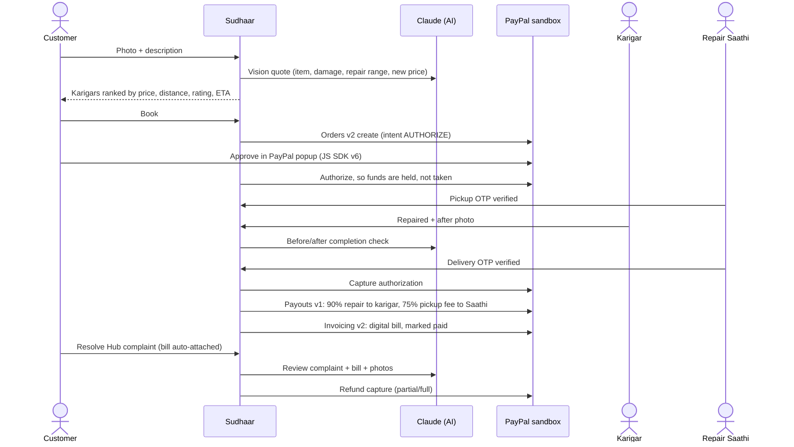

# Sudhaar — Repair, don't replace

**A doorstep repair marketplace for local karigars (informal repairers), built on PayPal + AI.**
Snap a photo of something broken. AI estimates the repair cost against the price of buying new. A verified local karigar fixes it, a Repair Saathi does the pickup and delivery, and the customer's PayPal payment is **held until the repaired item is back in their hands**. On the delivery OTP, PayPal captures the money and **instantly pays out the karigar and the Saathi**.

> Built by **Meenakshi Satpathy** (solo) for the [PayPal AI Hackathon 2026](https://paypalaihackathon.devpost.com/).
> 🌐 **Live demo:** the *Website* link in this repository's About section · 🎥 **Demo video:** on the Devpost project page

---

## Why I built this

This Diwali, my mother was sorting old things at home that only needed a small repair. Even though we live in a city, she struggled to find anyone to fix them. The karigars (cobblers, tailors, mixer and fan repairers) are right there in our neighbourhood, but nobody can find them online, nobody comes home to collect the items, and nobody knows what a fair price is. So people buy new and throw the old one away.

Sudhaar fixes each of those problems:

| Problem | How Sudhaar solves it |
|---|---|
| "I don't know a good repairer nearby" | Verified karigars compared side by side by price, rating, **distance** and ready time |
| "I have to carry it to a shop and go back" | **Repair Saathi** pickup and delivery (plumbers and electricians do home visits) |
| "Is it worth repairing?" | **AI Snap & Quote**: repair-cost range vs. new price, so you see the saving |
| "I'll get overcharged / I can't trust a stranger" | Price shown upfront, **PayPal holds the money** until delivery, OTP at every handover |
| "What if it breaks again?" | 15-day warranty and **Resolve Hub**: complaint with the PayPal invoice attached, AI review, PayPal refund |
| Karigars get few customers and get paid late | Free listing, karigar keeps **90%** of the repair charge, **instant PayPal payout** |

## What it does (end to end)



### Repair Agent (agentic commerce)
`/agent` is a Claude tool-use agent that **acts for the customer**: *"My mixer jar blade is loose, get it fixed under $8 by Friday."* It quotes the job (with vision if a photo is attached), picks the karigar against the budget and deadline, **books it and creates the PayPal order**, tracks status, files warranty claims and **issues refunds up to a $5 policy limit that is enforced in code**. It uses **PayPal Agent Toolkit** tools for PayPal lookups (orders, invoices, refunds, transactions, disputes). The customer approves every payment in the PayPal popup, so the agent can never spend money on its own.

### 🪔 Ghar Safai Mode (my favourite feature)
Born from my mother's Diwali cleaning: walk around the house and snap every broken thing (a bag zip, a chappal, the mixer). Claude quotes each item, the best karigar is picked for each, **one Repair Saathi collects everything in one trip** (cheaper than separate pickups), and the customer makes **one PayPal payment**. On delivery PayPal captures it once and **Payouts splits it to every karigar for their own items** plus the Saathi. Each karigar repairs only their items in the Karigar app, with an AI photo check per item.

### 💞 Family Pay
Many parents live alone while their children work in other cities. A parent books the repair (even by voice), picks *Someone else pays*, and shares a WhatsApp link. The son or daughter opens `/pay/<order>` and **approves the PayPal payment from their own account**. The money is still only held until the item is back home.

### Built for real people
- **Talk to Sudhaar**: speak in **Hindi or English** (browser speech recognition, hi-IN / en-IN) and the agent's replies are **read aloud**, for elderly users and karigars who don't type.
- **English / हिंदी** toggle across the customer app.
- **Fix-or-Replace meter**: shows how much of the new price a repair saves.
- **Item Passport**: every repaired item gets a "second life" card with money saved and waste avoided.
- **Karigar profiles** (craft, years of experience, languages, reviews, price list) and a **neighbourhood repair map**.
- Warm, hand-drawn **doodle illustrations** with a light **three.js** scene, designed for everyday phones.
- A **customer app** (Home · My Repairs · Talk · Profile) kept separate from the **partner side** (Saathi app, Karigar app, Admin console) behind a staff sign-in, the way real marketplaces work.

## How PayPal is used

All calls go to the PayPal **sandbox**. Every PayPal id appears on the order page and in the admin grid, so you can verify each one in the sandbox dashboard.

| PayPal capability | Where | What Sudhaar does with it |
|---|---|---|
| **JavaScript SDK v6** (`paypal-payments`, `<paypal-button>`) | [`components/PayPalCheckout.tsx`](components/PayPalCheckout.tsx) | Checkout popup on the order page and inside the agent chat |
| **Orders v2, intent `AUTHORIZE`** | [`lib/paypal.ts`](lib/paypal.ts) `createAuthorizeOrder`, `authorizeOrder` | Holds the customer's money at booking, works like escrow |
| **Payments v2 capture / void** | `captureAuthorization`, `voidAuthorization` | Captures only after the delivery OTP; voids if the customer cancels before pickup |
| **Payouts v1** | `sendPayouts` | Instant split to the karigar(s) and the Saathi the moment the job is confirmed. A Ghar Safai basket pays several karigars from one payment |
| **Invoicing v2** | `createPaidInvoice` | Generates, sends and marks paid a PayPal invoice: the "digital bill" used by Resolve Hub |
| **Refunds (Payments v2)** | `refundCapture` | Partial or full refunds from Resolve Hub (support desk or agent within limit) |
| **Webhooks** | [`app/api/paypal/webhook/route.ts`](app/api/paypal/webhook/route.ts) | Verifies signatures (`verify-webhook-signature`) and logs events on the order |
| **PayPal Agent Toolkit** | [`lib/agent.ts`](lib/agent.ts) | `get_order`, `get_invoice`, `list_invoices`, `get_refund`, `list_transactions`, `list_disputes` as agent tools |

## How AI is used in the product

Claude (`claude-opus-5-5`, via the official `@anthropic-ai/sdk`) with structured outputs ([`lib/ai.ts`](lib/ai.ts)):

1. **Snap & Quote**: vision → item, category, size, damage, repair price range, new price, turnaround, confidence.
2. **Completion check**: compares before/after photos **before the PayPal capture is allowed**. If the AI rejects a repair or is unavailable, the money stays held and the photos go to a person in **Admin console → Photo checks**. An error never releases a payment.
3. **Resolve Hub review**: reads the complaint, the PayPal invoice data and the photos, then recommends re-repair, partial refund or full refund under the warranty policy.
4. **Repair Agent**: multi-step tool use that books and pays (see above).

Without an `ANTHROPIC_API_KEY`, features 1–3 fall back to a deterministic estimator that is clearly labelled "Simulated" in the UI. The agent needs a key.

## How I built it (and how I used AI)

I'm a solo participant, a 3rd-year Computer Science student.

**My part:** I came up with the idea from a real problem at home, researched it, and designed the product and its features: OTP handovers, Repair Saathi pickup by local volunteers and students, Shiprocket-style distance pricing and tracking, Resolve Hub complaints with bill proof, KYC-verified karigars, and a fair split so karigars keep 90%. I also did the testing in the PayPal sandbox and made the demo video.

**AI as my coding assistant:** I used Claude Code (Anthropic's AI coding assistant) to turn my design into code. The first commit, the initial app, was generated with Claude Code from my specification. Later commits are my own changes, fixes and new features, made with AI assistance and reviewed and tested by me.

## Sponsor tools

- **AG Grid**: the Admin console at `/admin` (partner side) (orders, payouts, karigars, PayPal webhooks) with sorting, filtering and pagination.
- **Render**: one-click deploy via [`render.yaml`](render.yaml).
- **Postman**: [`postman/Sudhaar.postman_collection.json`](postman/Sudhaar.postman_collection.json) drives the whole flow through the API.

## Testing instructions for judges

**Hosted demo:** open the *Website* link in this repository's About section. It runs against the PayPal sandbox. Log in to PayPal with the sandbox buyer account given in the **testing instructions on the Devpost page**. On the free hosting plan, the first load can take about a minute while the server wakes up.

1. **Home** → tap a category (e.g. *Mixer & fan*), type or **speak** the problem (🎤, Hindi or English) or upload a photo → **Get AI quote** → see the **Fix-or-Replace meter**.
2. **Choose your karigar** (list or map) → **Book & pay with PayPal** → pay with the sandbox buyer. The status becomes **"Paid · on hold"** (authorization id shown) and live tracking starts.
3. In another tab open **`/partner`** and sign in with the demo access code **`sudhaar2026`** (the partner side is kept out of the customer app) → **Saathi app** → enter the **pickup OTP** shown on the order page → *Handed to karigar*.
4. **Karigar app** → *Inspect & start repair* → upload an after photo → **Mark repaired** (the AI completion check runs).
5. **Saathi app** → *Collect from karigar & go* → enter the **delivery OTP** → PayPal **captures**, sends **payouts** and issues the **invoice**. The order page shows the ids and an **Item Passport**.
6. Order page → **Resolve Hub** → *Report an issue* → AI recommends an action → in the **Admin console → Resolve Hub** tab, **Approve PayPal refund** → the customer's order shows the refund.
7. **Ghar Safai Mode** (home page banner) → add 2–3 items (e.g. *school bag zip*, *chappal sole*, *mixer blade*) → see the one-trip saving → **Review & pay once**. Optionally tick **Someone else pays**, enter a name and open the shared `/pay/…` link to pay as the family member. In the Karigar app, switch between karigars to repair each one's items; after delivery the order shows **one capture and one payout per karigar**.
8. **Talk** tab → tap the mic or type "My school bag zip broke. Get it fixed under $5." → approve the PayPal payment inside the chat. Replies are read aloud.
9. **Admin console** (partner side) → AG Grid views of **orders, customers, karigars, Saathis, payouts and PayPal webhooks**, plus the **Resolve Hub** queue where refunds are approved and the **Photo checks** queue for repairs the AI could not pass. *Reset demo data* clears orders.

## Run it locally

Requirements: Node 20+.

```bash
git clone https://github.com/meenakshisatpathy20-del/sudhaar-paypal.git
cd sudhaar-paypal
npm install
cp .env.example .env      # fill in the values below
npm run smoke:paypal      # optional: checks your PayPal sandbox credentials
npm run dev               # http://localhost:3000
```

The app also runs with an **empty `.env`**: PayPal and AI calls are then simulated and the header shows yellow "Simulated" badges. Add sandbox keys so the real PayPal flow runs.

### PayPal sandbox setup (5 minutes)
1. [developer.paypal.com](https://developer.paypal.com/) → **Apps & Credentials** → *Sandbox* → **Create App**. Copy the Client ID and Secret into `PAYPAL_CLIENT_ID` / `PAYPAL_CLIENT_SECRET`.
2. In the app's features, make sure **Payouts** and **Invoicing** are enabled.
3. **Sandbox → Accounts**: create two *Personal* accounts for the karigar and the Saathi. Put their emails in `PAYPAL_KARIGAR_EMAIL` / `PAYPAL_SAATHI_EMAIL`. Use the default sandbox *Personal* account as the buyer (`PAYPAL_CUSTOMER_EMAIL`).
4. Optional: add a webhook pointing to `https://<your-host>/api/paypal/webhook` and put its id in `PAYPAL_WEBHOOK_ID`.

### Environment variables
| Variable | Required | Purpose |
|---|---|---|
| `PAYPAL_CLIENT_ID`, `PAYPAL_CLIENT_SECRET` | for real PayPal | Sandbox REST app credentials |
| `PAYPAL_KARIGAR_EMAIL`, `PAYPAL_SAATHI_EMAIL` | for real payouts | Sandbox personal accounts that receive payouts |
| `PAYPAL_CUSTOMER_EMAIL` | optional | Invoice recipient fallback |
| `PAYPAL_WEBHOOK_ID` | optional | Enables webhook signature verification |
| `ANTHROPIC_API_KEY` | for real AI + agent | Claude API key |
| `AI_MODEL` | optional | Defaults to `claude-opus-5-5` |
| `DEMO_CENTER_LAT/LNG`, `DATA_DIR` | optional | Demo location and data folder |

## Project structure

```
app/(customer)/     Customer app: home, fix flow, ghar-safai (basket), orders/[id] tracking, repairs, talk (agent), profile, karigars/[id]
app/pay/[id]        Family Pay page the family member opens to pay with PayPal
app/(partner)/      Partner side (staff sign-in): partner hub, saathi, karigar, admin console (AG Grid)
app/api/            quote, baskets, orders (+approve/action/complaint/resolve), agent, karigars, admin, uploads, paypal/webhook
components/         UI (shadcn/ui components, doodles, three.js hero, PayPal SDK v6 checkout, voice, map, Family Pay, Fix-or-Replace meter…)
lib/
  paypal.ts         PayPal REST client (Orders, Payments, Payouts, Invoicing, Webhooks)
  ai.ts             Claude: quote, completion check, complaint review
  agent.ts          Repair Agent (Claude tool use + PayPal Agent Toolkit)
  orders.ts         Order state machine, OTP checks, settlement, Resolve Hub
  pricing.ts        Rate card (distance × size), split, haversine
  i18n.ts           English / Hindi strings
  db.ts / seed.ts   JSON-file store with seeded demo karigars
postman/            Postman collection for the full flow
scripts/            PayPal sandbox smoke test
```

## Notes
- Prices are in **USD** because the demo runs on the PayPal sandbox; they mirror real street-repair rates in Indian cities, and the app shows an approximate **₹ value** next to key prices (≈ ₹85 = $1).
- **Shared demo account:** there is no login, so everyone testing the hosted demo sees the same customer ("Anita") and the same orders. Use *Reset demo data* in the Admin console for a clean start. The partner sign-in is a demo gate (code `sudhaar2026`); production would use per-partner accounts.
- **Refund decisions are made by people:** customers raise issues in Resolve Hub; the AI recommends, and the support team approves in **Admin console → Resolve Hub**. Only the Repair Agent may auto-refund small amounts (up to $5), a limit enforced in code.
- **Fair use:** AI endpoints are rate-limited per visitor so the public demo can't be used to burn AI credits.
- Uploaded photos are stored on the server's disk; on free hosting they reset when the server restarts.
- Data lives in a JSON file (`data/db.json`) that is re-seeded automatically, so a fresh deploy always works.
- Built from scratch during the hackathon submission period (October–November 2026).

## License
[MIT](LICENSE)
