# Sudhaar screenshots

The app on a phone, screen by screen, from booking a repair to paying the karigar. Captured from a fresh demo run.

## 1. Book a repair

| Home | Compare karigars | Price and pickup time |
|---|---|---|
| 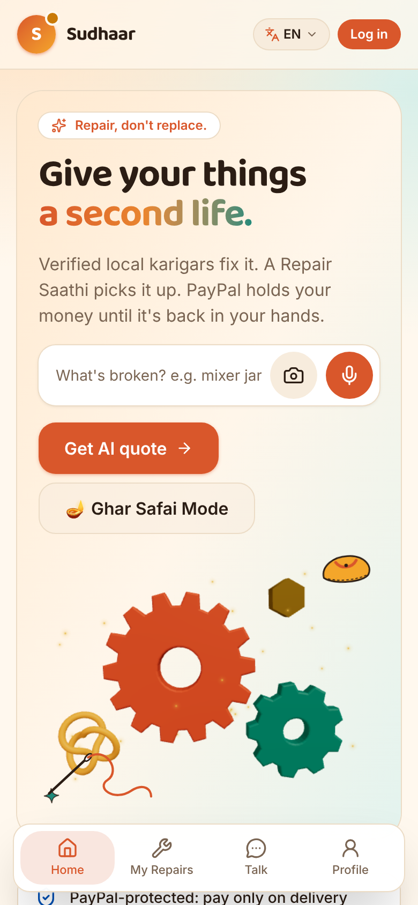 | 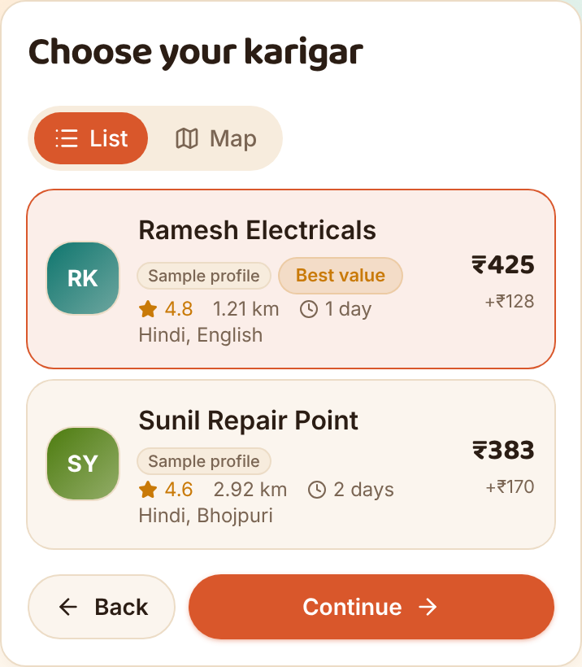 | 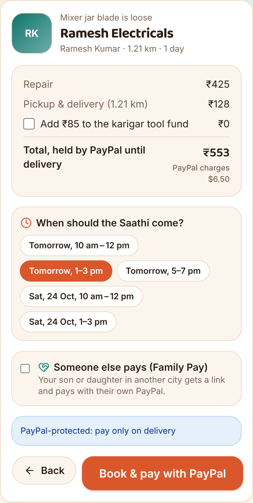 |
| Snap, type or speak what's broken; Ghar Safai for many items at once. | Karigars ranked by total price, distance and ready time. The pickup fee is set by distance and item size, courier-style. | Everything in rupees, the exact USD amount PayPal holds, and a pickup window. The tool-fund donation is opt-in. |

## 2. Pickup, repair and delivery

| Order with OTPs | Saathi's trip | Karigar's job |
|---|---|---|
| 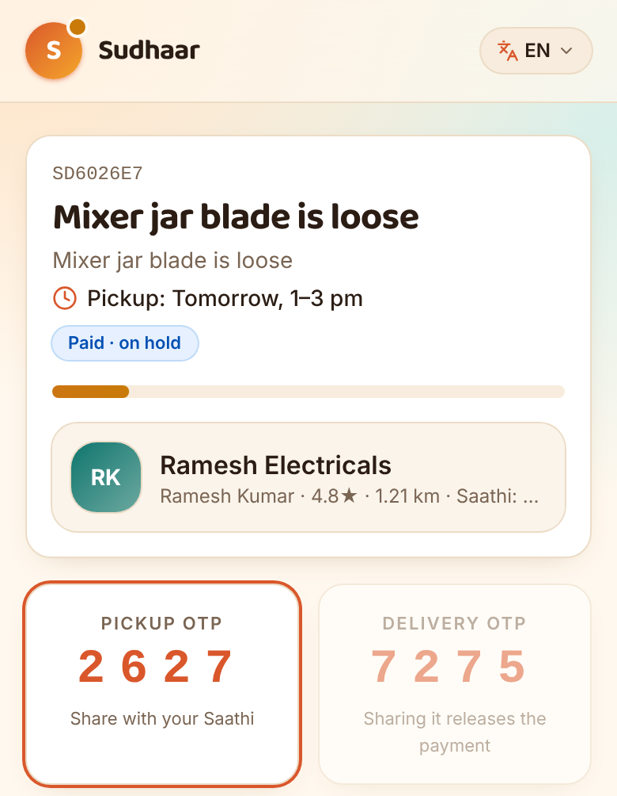 | 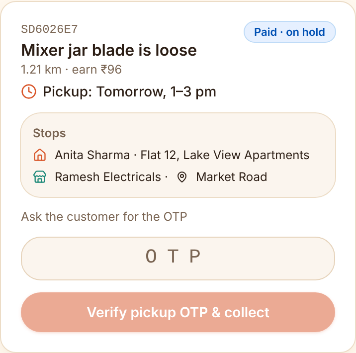 | 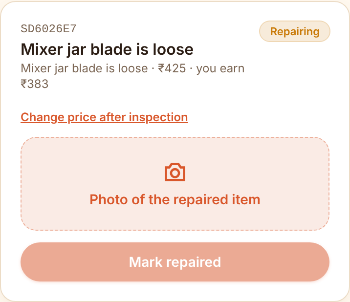 |
| PayPal holds the money. A pickup OTP and a delivery OTP protect every handover. | The Saathi sees the pickup window and every stop. OTPs come from the customer, never the app. | The karigar inspects, can ask the customer to approve a new price, and uploads an after photo for the AI check. |

## 3. After delivery

| Rate and tip | Item Passport | Verified review |
|---|---|---|
| 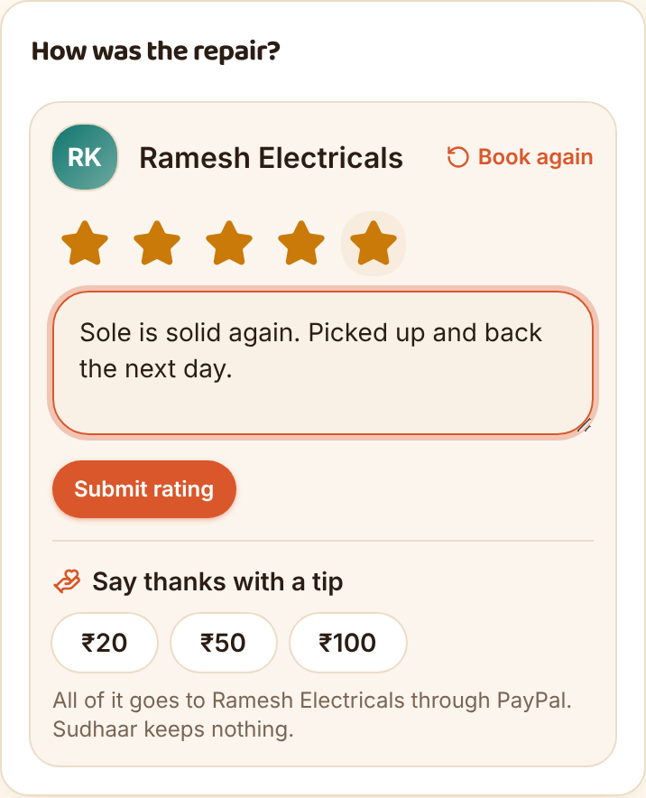 | 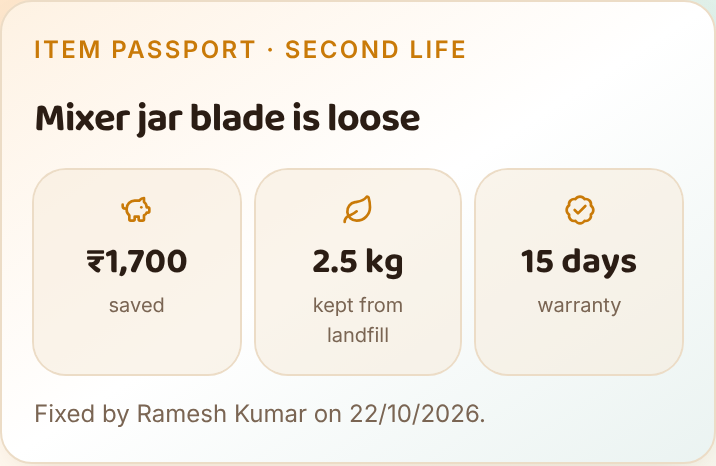 | 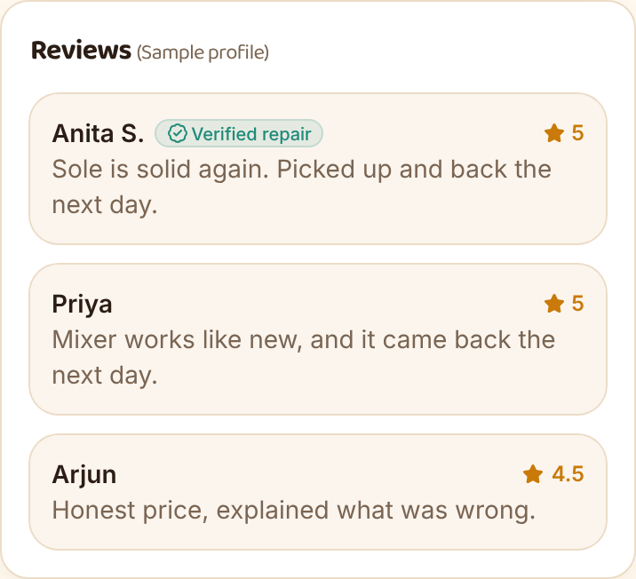 |
| Rate the karigar, tip ₹20/₹50/₹100 through PayPal (all of it goes to the karigar), or book again. | Money saved against buying new, waste kept out of landfill, and the 15-day warranty. | Reviews from real deliveries are marked *Verified repair*; ratings update from delivered orders. |

## 4. Ghar Safai, languages and joining

| Ghar Safai basket | हिंदी | தமிழ் | Become a Saathi |
|---|---|---|---|
| 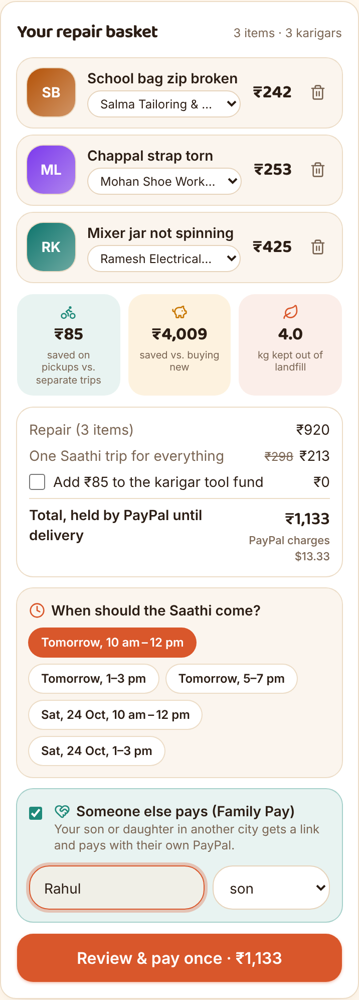 | 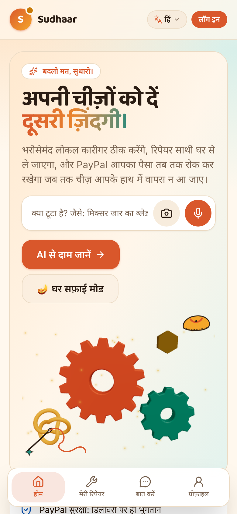 | 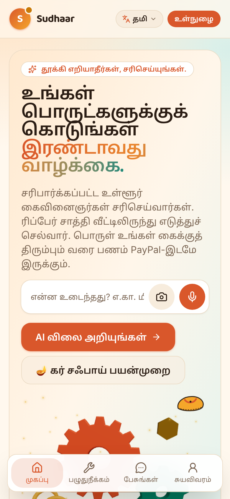 | 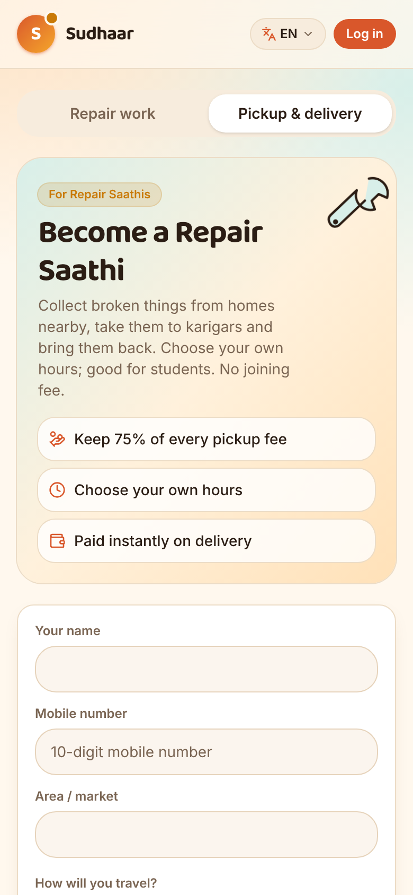 |
| Three items, three karigars, one Saathi trip (cheaper than three pickups) and one PayPal payment, optionally paid by family. | The whole app in 8 Indian languages. | Every script has its own font. | Students and local volunteers apply to be Saathis; karigars apply the same way. |
