# Sudhaar screenshots

A walk through the app, screen by screen. These were captured from a local run of the production build in **simulation mode** (no PayPal or Gemini keys), so the quote shows a "Simulated" badge and map streets are not loaded. The [live demo](../README.md#testing-instructions-for-judges) runs the real PayPal sandbox and Gemini.

## Customer app

| | |
|---|---|
|  | **Home.** Snap or speak what's broken, Ghar Safai Mode, and the PayPal promise: your money is held until the item is back. |

| Quote | Choose a karigar | Review and pickup time |
|---|---|---|
| 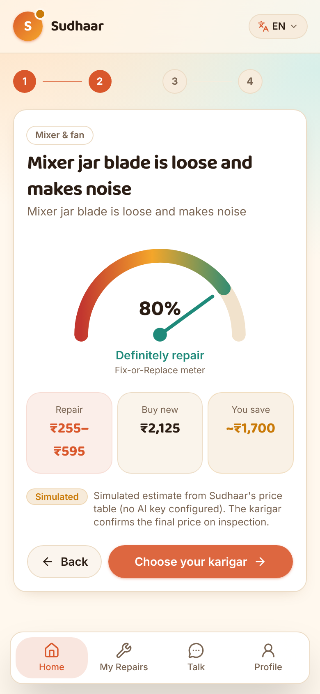 | 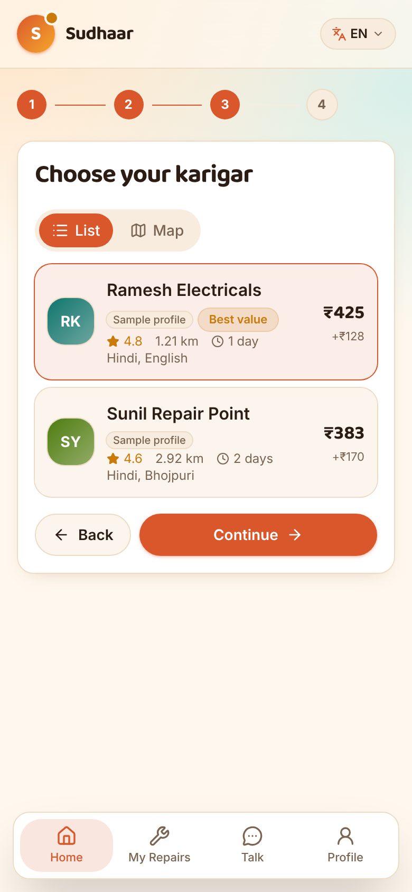 | 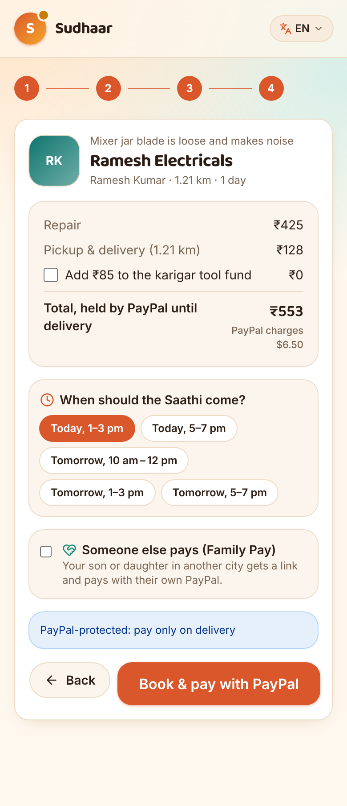 |
| AI quote in rupees next to the price of buying new (Fix-or-Replace meter). | Verified karigars compared by price, distance, rating and ready time. | Pick when the Saathi comes. The tool-fund donation is opt-in. Family Pay lets someone else pay. |

| Ghar Safai basket | Family Pay link | Live order |
|---|---|---|
| 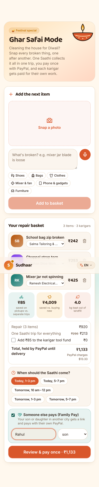 | 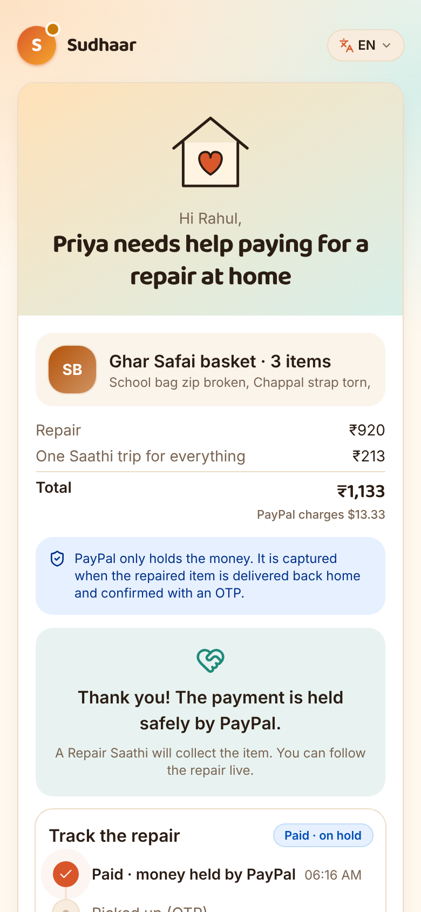 | 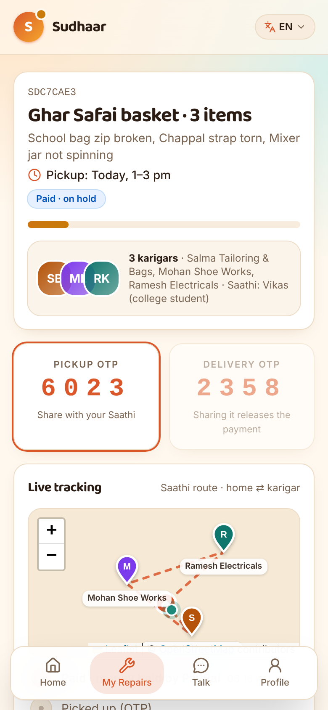 |
| Several broken things, one Saathi trip, one PayPal payment split across karigars. | A son or daughter opens the link and approves the PayPal payment, which is held until delivery. | Pickup time, OTP for every handover, and live tracking. |

| Rate and tip | Verified review |
|---|---|
| 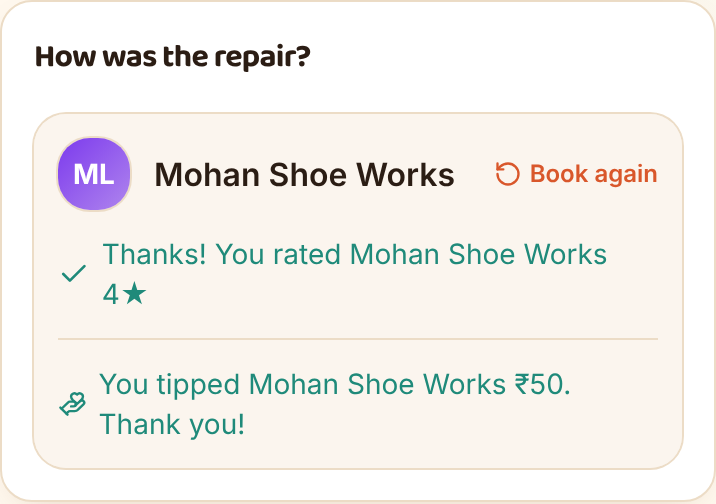 | 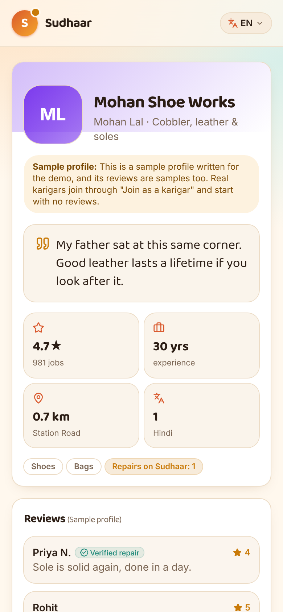 |
| After delivery: rate the karigar, tip through PayPal (all of it goes to the karigar), or book again. | Real reviews are marked *Verified repair*; ratings and job counts update from delivered orders. |

## Partner apps

| Saathi app | Karigar app |
|---|---|
| 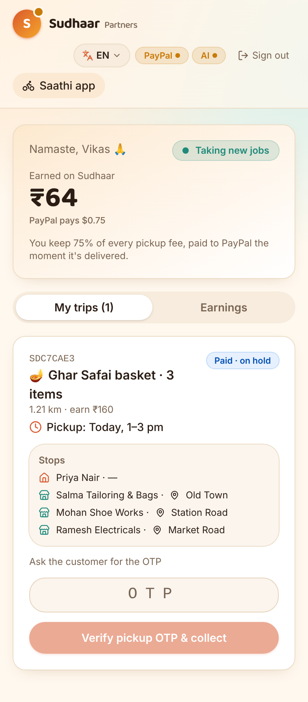 | 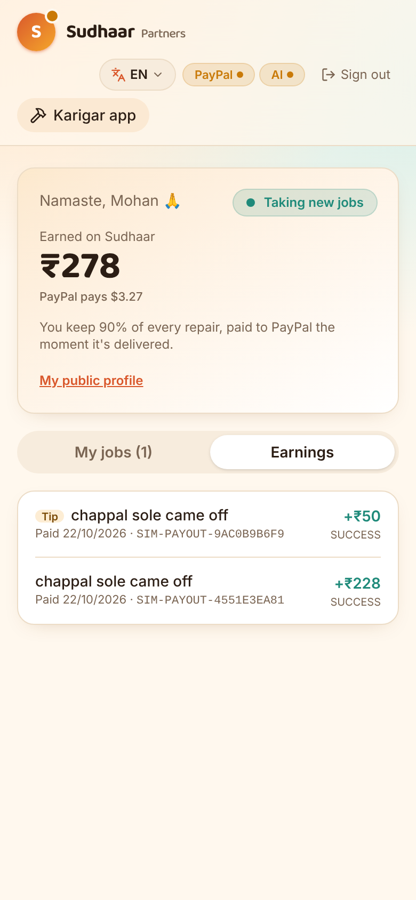 |
| The Saathi's own trips with the pickup time and stops. OTPs come from the customer, never the app. | Earnings from real PayPal payouts, including thank-you tips. |

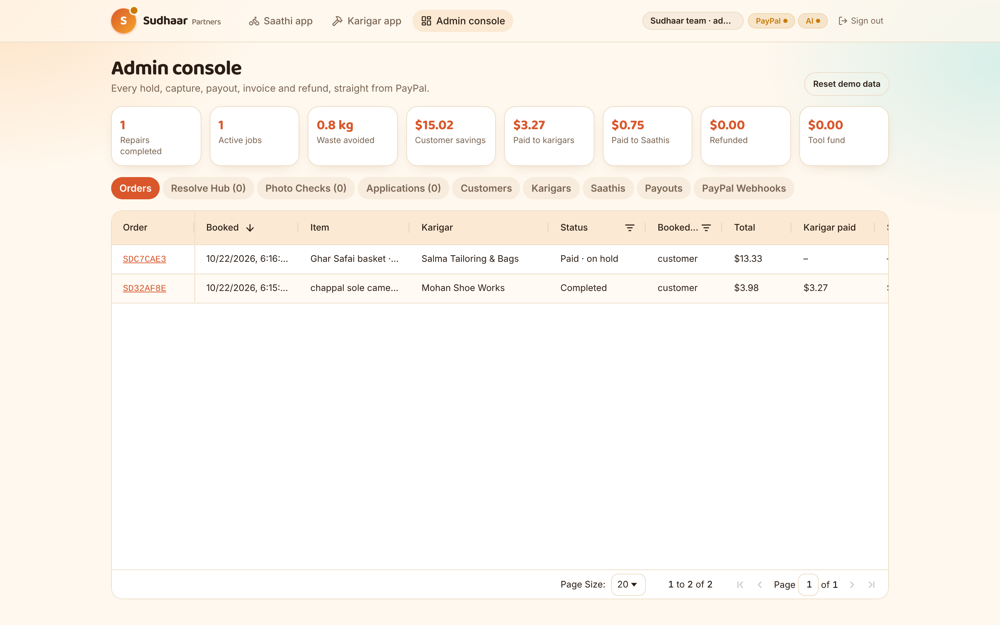

**Admin console** (AG Grid): orders, customers, karigars, Saathis, payouts and PayPal webhooks, with queues for refunds, photo checks and applications.

## For everyone

| In Tamil | Become a Repair Saathi |
|---|---|
| 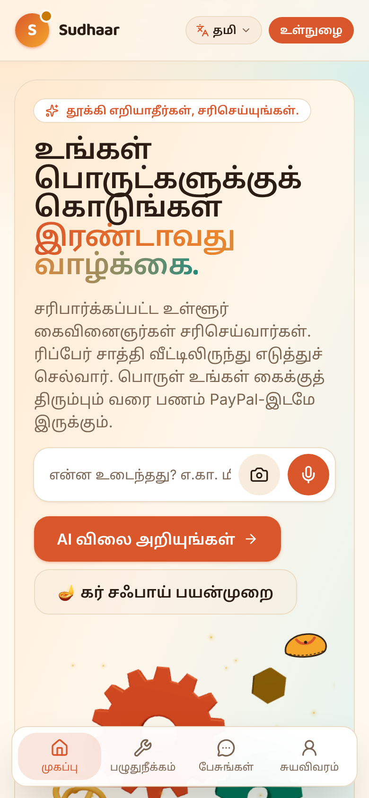 | 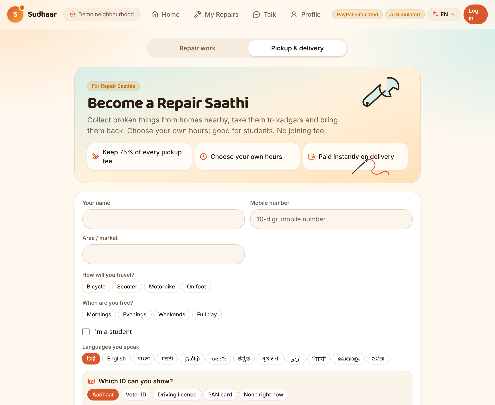 |
| The whole app in 8 languages: English, Hindi, Bengali, Marathi, Telugu, Tamil, Odia and Kannada. | Students and local volunteers apply to become Saathis; karigars apply the same way. |
